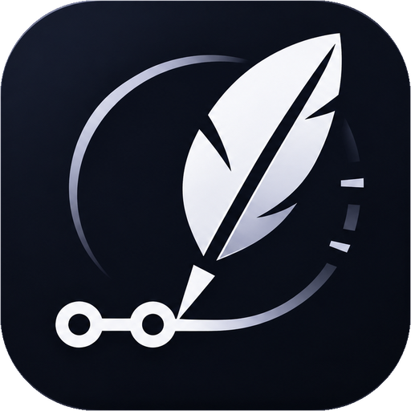

# GitChronicle

An AI assistant that automatically documents a GitHub repository and keeps the documentation up to date from the git history: after the first indexing, it processes only what changed since the last indexed commit, not the whole project from scratch.

Bachelor’s thesis project — Information Technology, 2026–2027.

The thesis plan and the journal under `docs/` are written in Romanian; everything else (this README, the interface, the generated content) is in English.

- The full plan of the thesis: [docs/licenta.md](docs/licenta.md)
- The step-by-step learning plan: [docs/plan-invatare.md](docs/plan-invatare.md)

## What it does

- **A workspace for each repository**: it opens on a showcase (what the project does, its numbers, the video and the first pages), with the sections as tabs at the top. Paste a `github.com` link with our domain instead and you land on the repository. `Ctrl+K` opens a command palette (sections, documentation pages, modules) and `Ctrl+I` opens the assistant in a side panel from any page. The interface is in English, with a switch for Romanian.
- **Documentation** DeepWiki-style: a page for each module, written to be read: an “On this page” outline, links to every heading, code blocks you can copy and a one-line time-travel bar.
- **C4 architecture diagrams** (Context, Container, Component), generated from the project’s code, with zoom, full screen, export (Mermaid, SVG, PNG) and nodes that open the module’s documentation page.
- **Code assistant**: answers questions about the repository and cites the exact file and lines; hovering a citation shows the code, and the starter questions and shared `?ask=` links can be sent in one click.
- **Incremental update**: on every push only the affected pages are regenerated.
- **Time travel**: a slider through the commit history shows what the documentation and the architecture looked like at any moment.
- **Presentation**: slides about the repository (PDF/PPTX) with its own identity (avatar, logo and colour from the project, not ours), built from the generated documentation and diagrams, with speaker notes.
- **Discover / leaderboard** *(bonus)*: the public “Discover” page with interesting GitHub repositories, ranked by how fast they gain stars (measured from daily snapshots), with the “repository of the day” and a “Document” button.
- **Short video** *(bonus)* for each repository, in English and in Romanian: it scrolls through its real GitHub page and frames what the voice says — what the project does, what problem it solves, how it is built, its numbers and how to get started.
- **Automatic Instagram posts** *(bonus)*: every day, a Reel with the leaderboard’s “repository of the day”.
- **Consulting** *(bonus)*: a report with bugs, vulnerabilities and risk zones (frequently changed files that also have problems), made with Semgrep, OSV-Scanner and scc, downloadable as Markdown.

## Status

**Current phase:** Phase 9 — Incremental update, done. On a new commit, GitChronicle fetches only the new commits (`git fetch` in the existing clone), finds out from `git diff` which files changed, propagates the change through the module graph (the changed modules and their neighbours one step away) and rebuilds only the pages, code chunks and diagram versions that were touched; above 40% changed files it reprocesses everything. A page written by Claude that Claude cannot rewrite right now stays, marked “out of date”, with the exact reason. The update starts from a GitHub webhook, from a scheduled check every 15 minutes or from the “Check for updates” button. Pages and diagrams keep their versions, so on “Documentation” and “Diagrams” you can “travel” to an older processed commit; the “History” tab shows, for each run, what changed, what was rewritten and what it cost. Before that: Phase 8 — the code assistant: the analyzed code is cut into chunks (functions, classes, line windows) and indexed with SQLite full-text search (FTS5); the assistant bar, at the bottom of every page of the repository, answers questions about the code with Claude and cites the exact files and lines on GitHub, and without AI it shows the fragments it found. Before that: Phase 7 — the architecture diagrams (layers and C4 Containers, Components, Context, drawn with Mermaid and ELK only from the code analysis and the project files, plus 1–3 “How it works” flows explained by Claude); Phase 6 — the generated documentation (a page for each module, “About the project” and a downloadable README, written by Claude or, without AI, by a template that uses only the facts from the analysis; pages whose code did not change are not rewritten again); Phase 5 — a Python analyzer with tree-sitter finds the classes, functions and imports, and Laravel groups them into modules. The repository page is a workspace: the table of contents with the chapters (documentation, architecture, modules grouped by folder, history) on the left, the chapter in the middle, the “Artifacts” panel on the right and the assistant bar at the bottom; chapters appear only when they have real data. The shared AI layer writes the texts through Claude Code, with the subscription (no API credits), or through the Anthropic API. The interface is English with a switch to Romanian (English is the default; the choice is remembered), and everything GitChronicle generates for a repository (documentation, diagram labels, assistant answers, slides, reports) is written in English. It has a dark theme (the default), with a switch to the light theme. Postgres, Redis and Horizon are postponed until deploy. Step-by-step progress is in [docs/plan-invatare.md](docs/plan-invatare.md).

**Discover (bonus):** done. The `php artisan discover:refresh` command, started daily by the Laravel Scheduler, uses the GitHub Search API to look for new and popular repositories, active ones or new ones per language, and records every day the stars of each tracked repository. The public “Discover” page (`/discover`) ranks them by the stars gained in 24 hours, 7 or 30 days, measured from two snapshots; until two snapshots exist, the growth is “unknown” and the order uses the average stars per day since creation, and the page says so. Each row has “Document” (adds it to GitChronicle) or “Open documentation”.

**History:** done. After the code analysis, GitChronicle imports the newest 500 commits from the clone (then only the new ones), with the files and lines changed. The “History” tab shows them by month, with the GitChronicle runs on the processed commits, search, “Hotspots” (the most frequently changed files) and contributors.
**Video (bonus):** rebuilt. A repository’s video scrolls through its real GitHub page (captured at generation time) and tells the story from start to finish, in English and in Romanian, with captions that highlight the spoken word and a sharp, 1:1 picture of the page and a natural-sounding voice. Every scene has an anchor verified in the README; when GitHub cannot be captured, the video uses typographic scenes and says why. Logged-in users can generate or redo it from the “Video and slides” page.

**Consulting (bonus):** done. Once a repository is ready, Semgrep (with rules written for GitChronicle), OSV-Scanner and scc read the clone; the “Consulting” page shows the problems by severity, the risk zones (commits × severity), the problems per file with links to the lines on GitHub, the vulnerable dependencies with the version that fixes them and the code statistics; a table of the runtime and framework versions the repository declares (PHP, Node.js, Python, Go, Ruby, Java, .NET, the big frameworks) against live public support data (end of life, missing security releases, where to change them), a “How current is this” line with the date of every data source and a notice when the report is older than 7 days; the report is downloaded as Markdown (in English).

**Day of 2026-11-13:** the analysis also reads shell scripts (functions, `source` and direct calls) and Rust (`mod`, `use crate::/self::/super::`, workspace crates, and paths through `pub use` re-exports, named or glob), and a repository with fewer than three modules gets a file-level component diagram instead of an empty one. The generated documentation now follows the order of a newcomer: what the project is, the problem, how it is solved, who it is for, how to get started and what to read next, with technologies and modules last; a module page starts with its role and where it sits. A pass over the whole interface (English and Romanian, both themes, desktop and phone) fixed the defects it found. Security fixes: per-user, per-address and global limits on adding repositories and asking questions, a daily budget of AI calls (`AI_DAILY_CALLS`), repository text fenced off in every prompt, security headers with a content policy, stricter passwords, and `REGISTRATION_OPEN=false` closes sign-up (the “Sign up” links disappear too). Processing a stranger’s repository is hardened step by step: closed environments for git, the analyzer and the other tools, https-only clones with a size check (`REPO_MAX_BYTES`, `REPO_MAX_FILES`, `REPO_STORAGE_BUDGET_BYTES`), paths kept inside the clone, caps on analysis (`ANALYSIS_MAX_*`), history (`HISTORY_MAX_*`) and search (`SEARCH_MAX_CHUNKS`), and a scanner answer larger than `CONSULTING_MAX_OUTPUT_MB` (8) is not read; a refusal is stored as a clear message in the visitor’s language. All limits are in `config/gitchronicle.php` and can be changed in `.env`.

**Day of 2026-11-12:** the interface and the generated content are in English by default (the whole interface has a Romanian switch; messages stored in the database, such as errors and video notes, are kept as translation keys and shown in the visitor’s language). New brand identity (ink, paper and ultramarine), a repository showcase with section tabs, a command palette and an assistant side panel; readable documentation pages; interactive diagrams; verifiable assistant answers; slides with the repository’s own identity; a sharper video with a human-sounding narrator; meaning and proof under the architecture diagrams (findings computed from the real imports, the evidence behind every arrow and a short validated reading; `php artisan repositories:diagrams {id|--all}` refreshes existing repositories). To get the voice engines for the video, run `composer media:install` once (it also installs the renderers’ Node packages).

## Technologies

✅ used · 🔄 in progress · ⏳ coming

| Technology | Role in GitChronicle | Phase | Status |
|---|---|---|---|
| Git | The project’s history; the “raw material” of the app, which reads the history of other repos | 0 | ✅ |
| GitHub | Hosts the project; repos are cloned from here, webhooks arrive and automatic PRs are opened | 0 | ✅ |
| PHP + Composer | The backend language and the PHP package manager | 0 | ✅ |
| Laravel 13 | The backend: routes, database, authentication, jobs, AI calls | 0 | ✅ |
| Artisan | The Laravel commands: server, file generation, migrations, workers | 0 | ✅ |
| Blade | The base HTML template in which React is mounted | 0 | ✅ |
| npm + Vite | The JavaScript packages; CSS/JS compilation and page reloading | 0 | ✅ |
| Tailwind CSS | The interface styling | 0 | ✅ |
| Inertia | Connects Laravel to React without a separate API | 1 | ✅ |
| React + TypeScript | The interface: pages, forms, chat, documentation | 1 | ✅ |
| PHPUnit | Tests for every feature | 1+ | ✅ |
| SQLite | The local database at the start | 2 | ✅ |
| Eloquent + migrations | The `users` and `repositories` tables and access to them | 2 | ✅ |
| Laravel queues + Process | The jobs that run `git clone` / `git diff` in the background | 3 | ✅ |
| Podman | Containers for Postgres and Redis; later the application image | 3, 4 | ⏳ |
| PostgreSQL | The main database | 3 | ⏳ |
| Redis + Horizon | The job queue and worker monitoring | 3 | ⏳ |
| Kubernetes + kind + Kustomize | Running the app, the database and the workers as in production | 4 | ⏳ |
| Python + tree-sitter | Code analysis: classes, functions, imports → the dependency graph | 5 | ✅ |
| Claude (Claude Code CLI or API, the official PHP SDK) | Generating the documentation, the reports and the chat answers; locally through Claude Code, with the subscription | 6, 8 | 🔄 |
| react-markdown + remark-gfm | Displaying the generated documentation and the assistant’s answers (Markdown without HTML) | 6, 8 | ✅ |
| Mermaid 12 + ELK | The architecture diagrams (layers, C4 Context/Container/Component) and the “How it works” flows, drawn in the browser | 7 | ✅ |
| Iconify “logos” (CC0) | The technology logos in the diagrams, saved locally (only the ones used) | 7 | ✅ |
| SQLite FTS5 (bm25) | Code search for the assistant: the fragments that best match a question | 8 | ✅ |
| pgvector + Voyage AI | Embeddings and semantic search for the assistant (optional, compared with FTS5) | 8 | ⏳ |
| GitHub webhooks | Start the incremental update on every push | 9 | ✅ |
| Semgrep, OSV-Scanner, scc | Consulting: bugs, vulnerabilities, code statistics | bonus | ✅ |
| Marp | The repository presentation as slides (PDF and PPTX) | 7 | ✅ |
| HyperFrames + FFmpeg | The short videos about the repository (HTML + GSAP → MP4) | bonus | ✅ |
| Puppeteer + Chrome | The capture of the real GitHub page that the video scrolls through | bonus | ✅ |
| Kokoro, Piper TTS (edge-tts optional) | The video voices: a male narrator in English and Romanian, generated locally; one setting per language picks the voice | bonus | ✅ |
| GitHub Search API + Laravel Scheduler | Leaderboard: records repos’ stars daily and computes who grows fastest | bonus | ✅ |
| Instagram Graph API | Automatic posting of the “repository of the day” Reel | bonus | ⏳ |
| k3s + KEDA | Deploy on a VPS; workers scale with the queue length | 10 | ⏳ |

## Development plan

**The goal: the complete application by January 2027.** From January: only adjustments, measurements and writing the thesis.

Pace: one phase per week. Kubernetes comes at the end, as a deploy step; until then Postgres and Redis run in plain Podman containers.

| Week | Phase | Result | Status |
|---|---|---|---|
| 28 Oct – 3 Nov 2026 | 1. Inertia + React + TypeScript | The start page in React, with a test | ✅ |
| 4 – 10 Nov | 2. Users and repositories | Public application; login only to add a repo, then it is added on its own | ✅ |
| 11 – 17 Nov | 3. Jobs + Postgres, Redis, Horizon | 🏁 The application clones a repo and shows its SHA | 🔄 |
| 18 – 24 Nov | 5. Code analysis (tree-sitter) | The modules and dependencies of a repo | ✅ |
| 25 Nov – 1 Dec | 6. AI-generated documentation | 🏁 Complete documentation for a small repo | ✅ |
| 2 – 8 Dec | 7. C4 diagrams + presentation (Marp) | Diagrams and slides for a repo | 🔄 |
| 9 – 15 Dec | 8. The code assistant (RAG) | Answers with the file and lines cited | ✅ |
| 16 – 22 Dec | 9. Incremental update + webhook + time travel | 🏁 The core of the thesis works; the architecture’s history per commit | ✅ |
| 23 Dec – 5 Jan | 4. Kubernetes + k3s deploy | The application online | ⏳ |
| January | Adjustments + experiments + bonuses | Measured results for the thesis. If time is left: leaderboard → video → Instagram, then consulting | ⏳ |
| February – June 2027 | The written thesis | The thesis submitted | ⏳ |

## How I work

1. A small step = a commit; push at the end of every working day.
2. A phase is done only when its result works and has a test.
3. For each phase, the decisions and their reasons are noted, for the thesis.
4. The core (phases 1–9) before the bonuses (leaderboard, video, Instagram, consulting).

## Running locally

Requirements: PHP 8.3+, Composer, Node.js 22+, Python 3.10+.

```bash
composer install
cp .env.example .env
php artisan key:generate
php artisan migrate
npm install
composer analyzer:install   # the code analyzer: analyzer/.venv + the tree-sitter grammars
composer media:install      # optional, for video and slides: renderers/node_modules + renderers/tts/install.sh (the voices)
composer consulting:install # optional, for consulting: Semgrep, OSV-Scanner and scc in scanners/ (no root)
```

Then, in three terminals:

```bash
php artisan serve       # the application, on http://127.0.0.1:8000
npm run dev             # Vite: CSS/JS and automatic reloading
php artisan queue:work  # the worker that runs the jobs (cloning, code analysis, documentation)
```

Or everything in a single terminal: `composer run dev`. Without a worker, added repositories stay “Queued”. For those added before Phase 3: `php artisan repositories:process --all-pending`.

The presentation video (one per language: `MEDIA_LANGUAGES=en,ro`) and the slides (PDF, PPTX) are made once the repository is ready, on the separate `media` queue, or on demand, with the button on the “Video and slides” page or with `php artisan repositories:media {id} --force`. At generation time the repository’s GitHub page is captured, so internet access is needed (`MEDIA_CAPTURE=false` turns it off). `composer run dev` also starts its worker, and by hand it is `php artisan queue:work --queue=media`. They need `composer media:install`, Google Chrome and FFmpeg (their paths: `MEDIA_BROWSER_PATH`, `MEDIA_FFMPEG_PATH`, `MEDIA_FFPROBE_PATH` in `.env`); `MEDIA_AUTO_GENERATE=false` turns them off. By hand: `php artisan repositories:media {id}` (`--force` redoes them even for the same commit, `--now` renders them directly in the terminal). Each language's voice is one line in `.env` (`MEDIA_VOICE_EN`, `MEDIA_VOICE_RO`, written `engine:voice`); Piper is the fallback. The tools, the voices and their licenses are in [renderers/README.md](renderers/README.md).

Consulting (bugs, vulnerabilities, risk zones, code statistics) also runs on the `media` queue, after every processing (`CONSULTING_AUTO_RUN=false` turns it off). By hand: `php artisan repositories:consult {id}` (`--force` redoes it for the same commit, `--now` runs the tools directly in the terminal). It needs `composer consulting:install`; a missing tool appears on the page as “Not installed”. `php artisan repositories:consult --stale[=days]` (daily in the scheduler) redoes the reports older than 7 days on the stored clone, and `composer scanners:update` (weekly in the scheduler) refreshes the community Semgrep rules. During an analysis, the only things that leave the computer are product names such as “php” (asked to endoflife.date, nodejs.org and php.net) and the names, versions and ecosystems of the packages in the lock files, sent by OSV-Scanner to `api.osv.dev`. The details, versions and licenses: [scanners/README.md](scanners/README.md).

The “Discover” ranking: `php artisan discover:refresh` collects today’s stars (it takes a few minutes, because it waits 8 seconds between searches to stay under the GitHub limit). Every day it is started by the Laravel Scheduler: on a server through cron (`* * * * * php artisan schedule:run`), locally with `php artisan schedule:work`; the time is `DISCOVER_SCHEDULE_TIME` (default 03:00), and `DISCOVER_SCHEDULE_ENABLED=false` turns it off. It works without a GitHub account; an optional `GITHUB_TOKEN` (any personal token, with no permissions) raises the API limits. The 24-hour growth appears after the second day with snapshots, the 7- and 30-day ones after as many days.

The documentation of an already analyzed repository can also be written directly from the terminal: `php artisan repositories:document {id}` (`--force` rewrites the unchanged pages too, `--page=overview` writes only the given pages).

### Incremental update (Phase 9)

An already processed repository is updated in three ways; each does a `git fetch` and rebuilds only what changed since the last successfully processed commit:

- **The “Check for updates” button** in the repository’s top bar (only for logged-in users, on a “Ready” repository).
- **The scheduled check:** `php artisan repositories:check-updates` (or `… check-updates {id}`) asks GitHub for the latest commit (`git ls-remote`, without cloning) and starts the update only if it is a different one. It runs by itself every 15 minutes (`UPDATES_CHECK_CRON`; empty = off), but only if the scheduler is running too: locally `php artisan schedule:work`, on a server `* * * * * php artisan schedule:run` in cron.
- **The GitHub webhook:** put a long secret in `.env`, `GITHUB_WEBHOOK_SECRET=…` (without it, the address answers 404). On GitHub, in the repository → Settings → Webhooks → Add webhook: *Payload URL* `https://<the-application-address>/webhooks/github`, *Content type* `application/json`, *Secret* the same as in `.env`, *Just the push event*. GitHub must be able to reach the application, so locally a tunnel is needed (for example `cloudflared tunnel --url http://127.0.0.1:8000` or `ngrok http 8000`), and the tunnel’s URL goes into *Payload URL*. Only pushes to the main branch of a repository added to GitChronicle and in the “Ready” state count.

The webhook and the scheduled check start at most one update per `UPDATES_MIN_INTERVAL_MINUTES` (default 10) per repository, so a burst of pushes does not call the AI several times; the commit that arrived in the meantime is caught by the next check. Above `INCREMENTAL_FULL_THRESHOLD` (default 40%) changed files, everything is reprocessed. A full reprocessing on demand: `php artisan repositories:process {id} --full`.

**Incomplete repositories.** A “Ready” repository that is missing something the processing makes (the history, the documentation, the diagrams or the assistant index; for example one processed by an older version) gets a full processing, even if there is no new commit on GitHub: from “Check for updates”, from the webhook and from the scheduled check (the latter only once per commit). Next to “Check for updates” is **“Regenerate everything”** (with confirmation, for logged-in users, on a “Ready” or failed repository): a full processing, all the stages again (pages whose context did not change stay the same). All the incomplete ones at once, from the terminal: `php artisan repositories:process --all-incomplete`. The video and the slides do not make a repository incomplete: they have their own queue (`repositories:media`).

**Administrator.** The role is given only from the terminal, to an existing account: `php artisan users:admin {email}` (`--revoke` takes it back). An administrator can do on any repository what the person who added it can do, for example delete it.

The measurement for the thesis: `php artisan gitchronicle:benchmark {id} --commits=5` replays the clone’s last N commits in a separate database and a separate copy of the clone (the application’s data is not touched) and compares, for each commit, the incremental update with processing from scratch: the time of each step, the files parsed, the pages written and the context characters that would be sent to Claude. By default it does not call the AI: the tokens appear only as an **estimate** (characters / the characters-per-token ratio measured on the pages already written by Claude), and `--ai` uses the configured driver. The results are saved as JSON and CSV in `storage/app/private/benchmarks/`. It needs the network once, so that git downloads the content of the old commits.

The AI texts: in `.env`, `AI_DRIVER=claude-code` writes them with the Claude Code CLI logged in on the laptop (the subscription, no API credits; its path in `CLAUDE_CODE_BIN`), `AI_DRIVER=claude` uses the API (needs `ANTHROPIC_API_KEY`), and `AI_DRIVER=none` works without AI.
